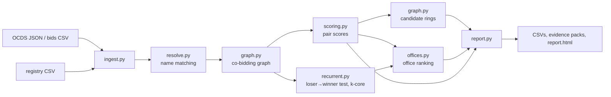

# bid-ring-detector

A small Python prototype that screens public procurement data for firms that may be cover bidding or rotating wins. It works mainly from who bid and who won, with optional registry and bid-timing signals.

It is inspired by Villamil and Kertész (2026), who applied a network method to 200,065 contracts from district engineering offices of the Philippine Department of Public Works and Highways. This repository does not reproduce their method or their results. See [How this relates to the paper](#how-this-relates-to-the-paper).

> **All data in this repository is synthetic.** Firm names, people, addresses, offices, amounts and dates were generated at random by `generate_data.py`. They do not describe any real firm, person or contract. Every data file name starts with `synthetic_`. No results on real data are claimed.

## What it does

Given bids (OCDS-style JSON or a flat CSV) and a corporate registry, it:

1. loads the bids into a tidy table (and optionally SQLite);
2. resolves the bidder names typed on each bid to registry firm IDs;
3. builds a co-bidding graph (firms linked when they bid on the same tender);
4. scores each pair that bid together often;
5. tests for directed "recurrent loser → recurrent winner" links;
6. groups flagged pairs into candidate rings;
7. ranks procuring offices by exposure;
8. writes CSV evidence packs per flagged pair and an HTML report.

Flags are leads for a reviewer, not findings of collusion.

## Architecture



The same flow in plain text:

```
bids (JSON/CSV) + registry
        │
   ingest.py ──► SQLite (optional; use Postgres in production)
        │
   resolve.py   name → firm_id
        │
   graph.py     co-bidding graph (networkx)
        ├──────────────► recurrent.py  loser→winner links, k-core
   scoring.py   overlap, behaviour, timing, registry
        │                       │
   graph.py     candidate rings │
        │                       │
   offices.py   ◄───────────────┘  flagged share, tender exposure
        │
   report.py    CSVs, evidence/, report.html
```

## Repository layout

```
bidring/
  config.py      thresholds and weights (one dataclass, JSON overrides)
  ingest.py      load OCDS JSON or flat CSV; write SQLite
  resolve.py     name normalisation and fuzzy matching to the registry
  graph.py       co-bidding graph; candidate rings
  scoring.py     pair signals and composite score
  recurrent.py   directed recurrent-loser test, Benjamini-Hochberg, k-core
  offices.py     office ranking
  report.py      evidence packs and HTML report
  pipeline.py    runs all steps; command-line entry point
generate_data.py synthetic data generator (planted rings)
validate.py      precision/recall against the planted rings
config.example.json               all settings with defaults
config.bidder_winner_only.json    uses bidder and winner data only
data/            synthetic input data
sample_output/   output from a run on data/ (synthetic)
tests/           pytest suite
```

## The signals

For each pair of firms that bid together at least `min_cobids` times:

| Signal | Meaning | Needs |
|---|---|---|
| `overlap` | shared tenders ÷ (tenders of the less active firm + `overlap_prior`) | bidders |
| `behaviour` | share of shared tenders won by the pair's recurring core group | bidders, winner |
| `timing` | share of shared tenders where both bids came in within `timing_window_minutes` | submission times |
| `registry` | 1.0 shared director; 0.75 shared address only | registry |

The score is a weighted sum. Two extra fields help a reader: `cover_bidder` (a firm in the pair that wins under 5% of its bids anywhere) and `rotation` (how many core firms took turns winning).

Separately, `recurrent.py` tests every ordered pair (loser L, winner W): does W win more often when L bids than on W's other contested tenders? It uses a one-sided binomial test with a smoothed baseline and Benjamini-Hochberg correction. Significant links form a directed graph; the maximum k-core of linked firms is reported per office. Office `tender_exposure` is the share of contested tenders involving such a link.

All thresholds are in `bidring/config.py`. Override any of them with a JSON file (see `config.example.json`).

## How to run

Python 3.10 or later.

```bash
python -m venv .venv
source .venv/bin/activate        # Windows: .venv\Scripts\activate
pip install -r requirements.txt

# 1. Make synthetic data (already in data/; this regenerates it)
python generate_data.py --seed 42 --out data

# 2. Run the pipeline
python -m bidring.pipeline \
    --bids data/synthetic_tenders_ocds.json \
    --registry data/synthetic_registry.csv \
    --out output \
    --sqlite output/bids.sqlite

# 3. Check the planted rings are found
python validate.py

# Bidder-and-winner data only (no timing, no registry)
python validate.py --config config.bidder_winner_only.json

# 4. Tests
pytest
```

Open `output/report.html` in a browser. A copy from the synthetic data is in `sample_output/`.

## Outputs

| File | Contents |
|---|---|
| `report.html` | summary, candidate rings, flagged pairs, recurrent links, office ranking |
| `flagged_pairs.csv` | pairs at or above `flag_threshold`, with every signal |
| `all_scored_pairs.csv` | every pair scored, for threshold checks |
| `evidence/<firm_a>__<firm_b>.csv` | every bid on the tenders the pair shared: amounts, % of winning bid, submission times, winner |
| `candidate_rings.csv` | firms grouped by connected flagged pairs |
| `recurrent_relationships.csv` | significant loser → winner links |
| `office_risk.csv` | offices ranked by flagged share; tender exposure; k-core |
| `name_resolution.csv` | each typed name, the firm it was matched to, and the match score |
| `config_used.json` | the settings used |

## Validation on synthetic data

`generate_data.py` plants four rings in 5,000 tenders, 400 firms and 40 offices (2022–2025):

| Ring | Firms | Tenders | Pattern | Registry link | Bids minutes apart |
|---|---|---|---|---|---|
| R1 | 4 | 70 | rotating winner | shared director | yes |
| R2 | 3 | 50 | one winner, two pure cover bidders | shared address | yes |
| R3 | 5 | 60 | rotating winner | none | yes |
| R4 | 3 | 40 | rotating winner | director and address | no |

The background market has skewed firm sizes, firms that favour particular offices, misspelt and re-cased bidder names, and sister firms whose names differ only in legal form.

Results with seed 42 (`sample_output/validation_synthetic*.txt`):

| Setting | Flagged pairs | Precision | Recall | Rings matched exactly |
|---|---|---|---|---|
| Default (all four signals) | 22 | 1.000 | 1.000 | 4 of 4 |
| Bidder and winner only, threshold 0.70 | 23 | 0.957 | 1.000 | 4 of 4 |

Over seeds 1, 7, 123 and 2024, the default setting again scored 1.000 / 1.000. The bidder-and-winner-only setting ranged from 0.870 to 0.950 precision and 0.773 to 0.909 recall. Name resolution was 99.8–100% correct, with two wrong-firm matches across all five seeds. The directed loser → winner test found the cover ring (R2) on every seed and a rotating ring only once (R3, seed 2024). That is expected: in a rotating ring every member wins its turn, so no one firm wins much more often when another bids. Pair scoring is what catches rotation.

These numbers show the code finds what the generator planted. The planted rings are deliberately clear. They say nothing about how the method performs on real data, where rings are subtler, markets are thinner and ground truth is rarely known.

## Limits

- **Synthetic only.** Nothing here has been run on real procurement data.
- **Signals are not proof.** Firms bid together in thin local markets for honest reasons. A shared address can be a business centre. Close submission times can come from a shared courier or a portal deadline.
- **Thresholds are hand-set.** Defaults were chosen on synthetic data. Real use needs calibration against known cases, and the score scale changes when signals are switched off (hence the separate 0.70 threshold for bidder-and-winner only).
- **Name matching is basic.** Use registry numbers (SEC, PhilGEPS, TIN) where available, and review matches below 1.0 in `name_resolution.csv`.
- **Markets are not defined.** The paper tests within markets (office and period). This prototype pools all tenders. Splitting by office and period is the obvious next step.
- **Scale.** The pair loop is fine for tens of thousands of tenders. For 200,000+ contracts, load into Postgres, compute pair counts in SQL, and run scoring per market.
- **No price screens.** Bid-gap and price-variance screens (common in the cartel-screening literature) are not included.

## How this relates to the paper

Villamil and Kertész use only bidder participation and winner identities. They test, within each market, whether firms win unusually often when particular competitors also bid; the significant relationships form a directed graph from recurrent losers to recurrent winners. They classify networks by maximum k-core and propose tender exposure (the share of contested tenders involving a reported relationship) as a market-level risk indicator. On 200,065 DPWH contracts (2017–2025) they report 8,728 directed relationships across 407 of 564 markets.

This prototype borrows those ideas in simplified form (`recurrent.py`, `tender_exposure`, `max_kcore`) and adds pair scoring, registry links and bid timing for the case where those data exist. The statistical test, market definitions and classification here are simpler than the paper's. Read the paper for the method itself.

## Citation

Villamil, I. and Kertész, J. (2026). *Recurrent losers: A network approach to cover-bidding patterns in public procurement.* arXiv:2611.20527. https://arxiv.org/abs/2611.20527

## Licence

MIT. See `LICENSE`.
